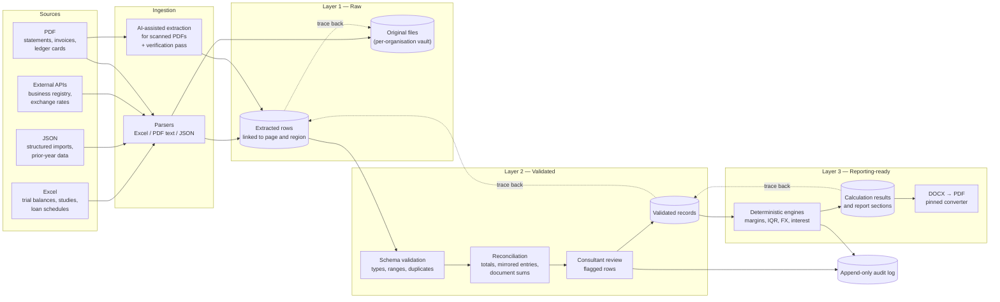
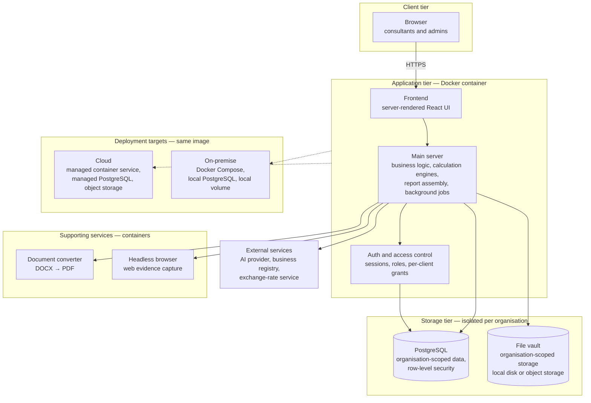
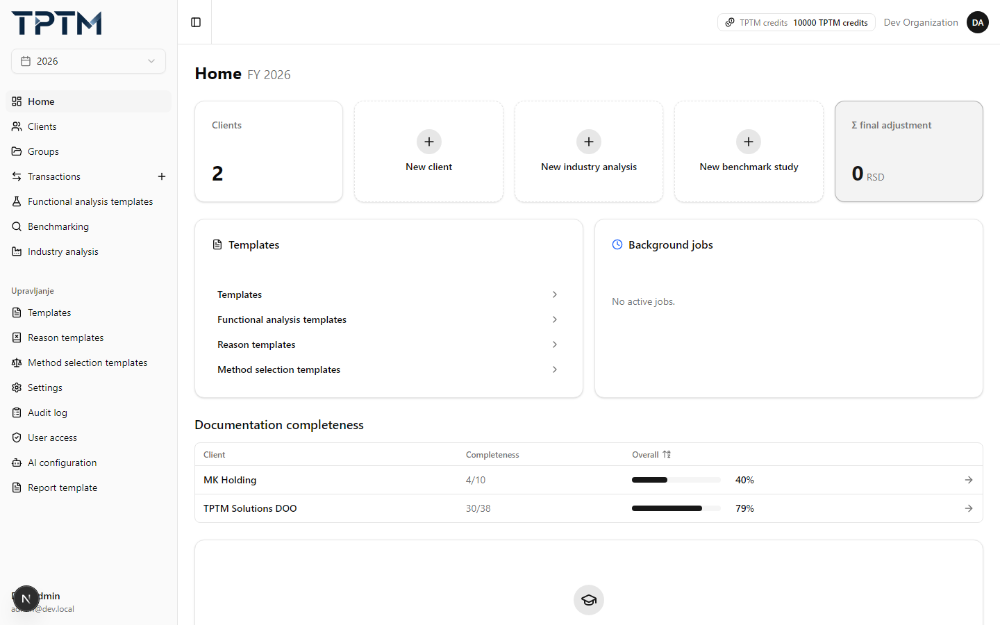
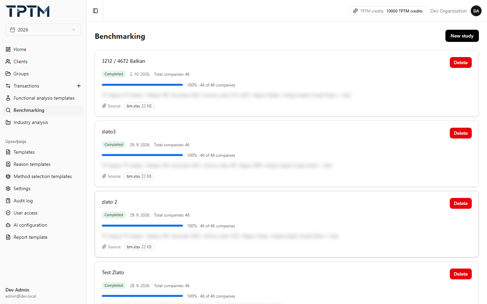
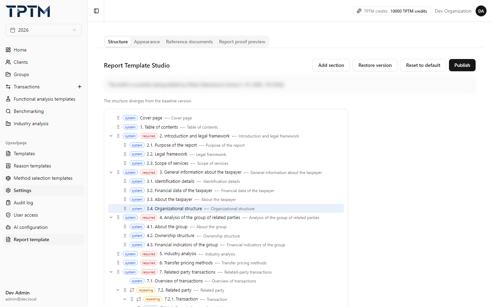

# TPTM Solutions — Platform Overview

> **Documentation only.** The source code of TPTM Solutions is private. This repository describes
> what the product does and how it is built. It contains no source code, configuration or data.

## What it is

**TPTM Solutions** is a SaaS platform for **transfer pricing benchmarking and report generation**.

When companies in the same corporate group trade with each other (goods, services, licences,
loans), tax law requires them to prove that their prices follow the *arm's length principle*:
the prices must match what unrelated companies would agree. Every year, these companies have to
prepare transfer pricing documentation. This includes financial analysis, a benchmark study of
comparable companies, a margin calculation for each transaction, and a formal report filed with
the tax authority.

TPTM Solutions is the production line for that work. Structured financial data and source
documents go in. A reviewed, versioned and audit-ready report (DOCX and PDF) comes out.

## The problem it solves

Transfer pricing documentation is traditionally built by hand from spreadsheets, scanned
documents and Word templates. This creates three recurring problems:

- **Slow, repetitive work.** The same data is retyped across spreadsheets and report chapters
  every year.
- **Errors that are hard to find.** A number in the final report cannot easily be traced back to
  the document it came from.
- **Weak audit trail.** When a tax authority asks "where does this margin come from?", the answer
  is spread across files and e-mails.

The platform replaces this with one workflow. Every figure is calculated deterministically and
can be traced back to its source.

## Main features

- **Client and group management.** Corporate groups, related entities, ownership structures and
  fiscal years.
- **Financial data import.** Excel trial balances, financial statements from a public business
  registry, and AI-assisted extraction from scanned PDFs, with a verification step.
- **Related-party transaction register.** Seven transaction types, plus a dedicated module for
  intercompany loans with daily exchange rates.
- **Functional analysis.** Functions, assets and risks for each transaction, written with AI help
  or from templates.
- **Method selection.** Choice of the transfer pricing method (CUP, Cost Plus, Resale Price,
  TNMM), supported by AI recommendations that cite regulatory sources.
- **Benchmarking.** Import of comparable-company studies, website-based screening and
  classification of each comparable, interquartile range calculation and Excel export.
- **Calculation engines.** Deterministic margin calculations for each method, including a
  step-by-step evidence wizard for comparable prices with captured web evidence.
- **Report assembly.** All report sections are filled in automatically. The report can then be
  edited in a WYSIWYG editor. A per-organisation template studio controls structure, numbering
  and visual style.
- **Approval workflow.** Draft → in progress → in review → locked → finished. Locking a report
  freezes all data underneath it.
- **Deterministic export.** The report is generated as DOCX and converted to PDF on the server
  with a pinned converter, so the same input always gives the same document.
- **Audit log.** An append-only record of every change: who changed what, with before and after
  values.

## My role

I am the **founder** of TPTM Solutions. I designed and built the platform end to end:

- product design and domain modelling, based on transfer pricing practice,
- data model, data pipelines and calculation engines,
- application architecture, security model and deployment,
- testing strategy, and work with users on feedback and releases.

---

## Data engineering

Data quality matters most in this product. A transfer pricing report is a legal document, so
every number in it must be correct, reproducible and explainable.

### How data flows through the system

1. **Ingestion.** Data comes in from several kinds of sources:
   - **Excel** files: trial balances, transaction lists, loan schedules, benchmark studies,
   - **PDF** files: financial statements, ledger cards, invoices and contracts. Text-based PDFs
     are parsed directly. Scanned PDFs go through AI-assisted extraction with a second
     verification pass,
   - **JSON** payloads: structured imports and data exported from earlier fiscal years,
   - **External APIs**: a public business registry for financial statements and an official
     exchange-rate service for daily currency rates.
2. **Validation.** Each input is checked against a typed schema shared by the client and the
   server. The checks cover required fields, data types, value ranges, fiscal-year consistency
   and duplicate detection. Rows that fail are flagged for review. They are never dropped
   silently.
3. **Reconciliation.** Imported figures are checked against each other before they are used.
   Examples: trial balance totals against financial statement lines, transactions against
   their mirrored counterpart entries in the related entity, and extracted line items against
   document totals.
4. **Layered data model.** Data moves through three clearly separated layers:
   - **Raw.** Original files and extracted rows, stored unchanged and linked to the source
     document.
   - **Validated.** Normalised, typed and reconciled records that the consultant has reviewed
     or confirmed.
   - **Reporting-ready.** Calculation results, benchmark ranges and report sections built only
     from validated data.
5. **Deterministic calculations.** The calculation engines (margins, interquartile ranges,
   currency conversion, interest benchmarks) are pure functions of their inputs. The same
   input always gives the same result. AI is used for reading documents and drafting text, and
   never for computing numbers.
6. **Traceability.** Every number in the final report can be traced back through the
   calculation and the validated record to the raw row, down to the page and region of the
   source document it was taken from. The append-only audit log records every manual change on
   the way.

---

## Architecture

The platform is one containerised web application that runs from **a single codebase**. It runs
both in the cloud and on-premise. Only environment configuration changes between the two.

**Key points**

- **One codebase, two deployment targets.** The same Docker image runs in the cloud and
  on-premise. Storage backend, PDF converter and scheduler are selected by configuration, not
  by code changes.
- **Isolation per organisation.** Every organisation (a consulting firm) has its own isolated
  data space. Database rows are scoped by organisation and enforced by PostgreSQL row-level
  security as a last line of defence. Files are stored in an organisation-scoped file vault.
  Access is checked before any file is served.
- **Auth and access control.** Server-side sessions, role-based permissions, and fine-grained
  access grants per client and fiscal year.
- **Long-running work in the background.** AI extraction, web evidence capture and document
  conversion run as background jobs, so the interface stays responsive.
- **Containerised.** A multi-stage Docker build produces a slim runtime image. Separate
  containers handle the document converter, database migrations and scheduled tasks. A health
  endpoint supports orchestration.
- **Planned next steps.** A standalone authentication service, and physical isolation with one
  database and one file vault per organisation behind a routing layer.

---

## Tech stack

| Area | Technologies |
| --- | --- |
| Language | TypeScript (strict mode) |
| Frontend | React, Next.js (App Router, Server Components), Tailwind CSS, shadcn/ui, Radix UI, TipTap editor, Chart.js |
| Backend | Next.js server (Server Actions and API routes), Node.js |
| Database | PostgreSQL, Drizzle ORM, row-level security, versioned migrations |
| Validation | Zod (schemas shared by client and server) |
| Documents | DOCX generation, server-side DOCX → PDF conversion, Excel and PDF parsing |
| AI | Anthropic Claude API: document extraction, text drafting, classification |
| Automation | Headless browser for web evidence capture |
| Infrastructure | Docker (multi-stage builds), Docker Compose, cloud container services, object storage |
| Testing | Vitest, Playwright |
| i18n | next-intl |

## Testing approach

- **Unit tests** cover the calculation engines, parsers, validators and permission rules. The
  calculation engines are pure functions and are tested against hand-checked reference
  examples.
- **Integration tests** run server actions and data-access functions against a real PostgreSQL
  test database. They check tenant isolation, access rules, lock behaviour and audit logging
  from start to finish.
- **End-to-end tests** (Playwright) cover the main user journeys in a real browser.
- **Golden-file tests** compare generated reports (structure and visual output) with approved
  reference versions, so any unintended change in a legally filed document is caught before
  release.
- Tests run on every change. Schema changes are applied to a separate test database before they
  reach production.

## Security practices (high level)

- **Isolation per organisation** at both the application and the database level
  (organisation-filtered queries plus PostgreSQL row-level security).
- **Least privilege.** Role-based permissions plus explicit access grants. Every write follows
  the same order: authenticate → authorise → validate → write → audit.
- **Strong credential handling.** Salted, memory-hard password hashing, hashed session tokens
  in httpOnly cookies, and rate-limited login.
- **Append-only audit log.** Deletes are blocked at the database level.
- **Safe file handling.** Ownership checks before every download, path-traversal guards, and
  private storage with no public file URLs.
- **Outbound request protection.** URLs used for web capture are checked against internal
  network ranges.
- **Secrets** come from the environment or a secret manager and are never stored in the code.
- **Encrypted backups** of both the database and the file storage.

---

## Screenshots

> Anonymised screenshots will be added here. All client data shown is fictitious.

| View | Screenshot |
| --- | --- |
| Dashboard |  |
| Financial data import |  |
| Benchmarking study |  |
| Calculation (margin vs. interquartile range) |  |
| Source document traceability |  |
| Report editor |  |
| Report template studio |  |

---

## Status

The product is **in use with clients** and is run as a **side business**.

## License and code availability

The **source code of TPTM Solutions is private** and is not part of this repository. This
repository contains **documentation only**. The text and diagrams in it are available under
the MIT License (see [LICENSE](LICENSE)). The license does not grant any rights to the TPTM
Solutions software, its source code or its trademarks.
